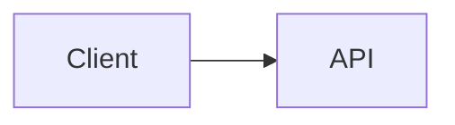

# Markdown Syntax Extension Design

## Context

This document keeps the implementation references for the integrated Markdown
syntax extension PR. It is based on the TUI optimization research from
`origin/docs/tui-optimization-design`, especially:

- `docs/design/tui-optimization/00-overview.md`
- `docs/design/tui-optimization/03-rendering-extensibility.md`
- `docs/design/tui-optimization/04-gemini-cli-research.md`
- `docs/design/tui-optimization/05-claude-code-research.md`
- `docs/design/tui-optimization/06-implementation-rollout-checklist.md`
- `docs/design/tui-optimization/08-execution-plan-and-test-matrix.md`

The referenced research recommends a long-term Markdown architecture built
around an AST parser, block/token caching, stable-prefix streaming, bounded
detail panels, and terminal capability detection. This first implementation
keeps the runtime footprint small and makes the new behavior visible
immediately.

## Integrated PR Scope

This PR treats Markdown syntax expansion as one coherent renderer improvement,
not separate feature PRs.

Included in the first implementation:

- Mermaid code blocks render visually in the TUI.
- `flowchart` / `graph` Mermaid diagrams fall back to box-and-arrow previews.
- `sequenceDiagram` Mermaid diagrams fall back to participant-arrow previews.
- Basic `classDiagram`, `stateDiagram`, `erDiagram`, `gantt`, `pie`,
  `journey`, `mindmap`, `gitGraph`, and `requirementDiagram` blocks fall back
  to bounded text previews.
- Mermaid types without a text preview fall back to their original fenced
  source so the user can still read and copy the diagram definition.
- Task list items render checked/unchecked markers.
- Blockquotes render with a visible quote bar.
- Inline `$...$` math and block `$$...$$` math render with common Unicode
  substitutions.
- Existing Markdown tables continue to use `TableRenderer`.
- Existing non-Mermaid fenced code blocks continue to use `CodeColorizer`.
- Rendered visual blocks keep source reachable through `/copy mermaid N`,
  `/copy latex N`, `/copy latex inline N`, and raw mode.
- `ui.renderMode` controls whether sessions start in rendered or raw/source
  mode, while `Alt/Option+M` toggles the active session view.

## Mermaid Rendering Strategy

Mermaid blocks render in-process as a terminal wireframe or bounded text
preview. Qwen Code does not invoke an external Mermaid renderer (Mermaid CLI,
Puppeteer/Chromium, or `chafa`) for diagrams. While a response is still
streaming, Mermaid blocks show a bounded pending preview.

### Resizable wireframe preview

The preview avoids async work because Ink's `<Static>` path is append-only: a
finalized message cannot reliably wait for a background render job and then
update in place without forcing a full static refresh. The preview must
therefore produce terminal output during the normal React render pass.

For `flowchart` / `graph` diagrams, the preview builds a lightweight graph
model instead of printing one edge at a time:

- Nodes are normalized by Mermaid id, label, and basic shape.
- Node labels support Mermaid-style `\n` / `<br>` line breaks.
- Top-down diagrams are ranked into horizontal layers.
- Left-to-right diagrams are ranked into vertical columns when they fit.
- Multiple outgoing edges from the same node are drawn as one fork with
  bracketed edge labels such as `[Yes]`, `[No]`, `[是]`, and `[否]`.
- Back edges and cycles are summarized in a `Cycles:` section with explicit
  `↩ to <node>` markers. This avoids unstable long cross-diagram routes in
  terminal fonts while keeping the loop semantics visible.
- The graph is recomputed from `contentWidth`, so resize changes node width,
  spacing, and connector paths.
- Large previews are bounded before graph layout so very large Mermaid blocks
  do not allocate an unbounded terminal canvas during render.

Example:



renders as a terminal visual preview rather than Mermaid source.

Other common Mermaid diagram families use bounded text summaries rather than a
full layout engine: class relationships/members, state transitions, ER
entities/relationships, Gantt tasks, pie slices, journey steps, mindmap trees,
git graph entries, and requirement trees. If a diagram type is unknown or not
previewable, the renderer shows the original fenced Mermaid source rather than
a placeholder so the content remains readable and selectable/copyable in the
terminal. Rendered Mermaid headings also show the Mermaid-specific copy command,
for example `/copy mermaid 2`, so users can recover the original diagram source
without switching the whole view to raw mode.

The preview is not a complete Mermaid engine. It is a fast, dependency-light
preview layer for common LLM-generated diagrams.

## AST Renderer Compatibility

The first version extends the existing parser to minimize blast radius. The
feature boundaries are still compatible with a future `marked` token pipeline:

- `code(lang=mermaid)` -> `MermaidDiagram`
- `code(lang=*)` -> existing `CodeColorizer`
- `table` -> existing `TableRenderer`
- `blockquote` -> quote block renderer
- `list(task=true)` -> task list renderer
- `paragraph/text` -> inline renderer with math/link/style support

The implementation does not cache React nodes. A future AST renderer should
cache tokens/blocks, then render from current width/theme/settings props.

## Safety And Performance

- Mermaid source is treated as untrusted input.
- The first renderer does not execute Mermaid JavaScript.
- Mermaid rendering never starts an external process.
- Rendering should degrade to terminal text instead of throwing.
- Large blocks should respect available height and width.

## Validation

Targeted unit verification:

```bash
cd packages/cli
npx vitest run \
  src/config/settingsSchema.test.ts \
  src/ui/AppContainer.test.tsx \
  src/ui/utils/MarkdownDisplay.test.tsx \
  src/ui/utils/MermaidDiagram.test.tsx \
  src/ui/commands/copyCommand.test.ts \
  src/ui/components/BaseTextInput.test.tsx \
  src/ui/keyMatchers.test.ts \
  src/ui/contexts/KeypressContext.test.tsx
```

Broader verification before PR submission:

```bash
npm run build --workspace=packages/cli
npm run typecheck --workspace=packages/cli
npm run lint --workspace=packages/cli
git diff --check
```

Terminal-capture integration scenario:

```bash
npm run build && npm run bundle
cd integration-tests/terminal-capture
npm run capture:markdown-rendering
```

This scenario captures a Markdown-heavy model response, toggles raw/source mode
with `Alt/Option+M`, and verifies the visible source copy flows with
`/copy mermaid 1` and `/copy latex 1`.

Manual scenarios:

- Assistant response with a Mermaid `flowchart LR` block.
- Assistant response with a Mermaid `sequenceDiagram` block.
- Markdown table plus Mermaid in the same answer.
- Fenced JavaScript code block still showing code formatting.
- Narrow terminal width.
- Constrained tool/detail surface.
- `ui.renderMode: "raw"` starts a session in source-oriented mode.
- `Alt/Option+M` toggles the same response between rendered and raw/source
  mode.
- Mermaid and LaTeX visual blocks expose copy hints that map to the actual
  `/copy mermaid N` and `/copy latex N` source order.
