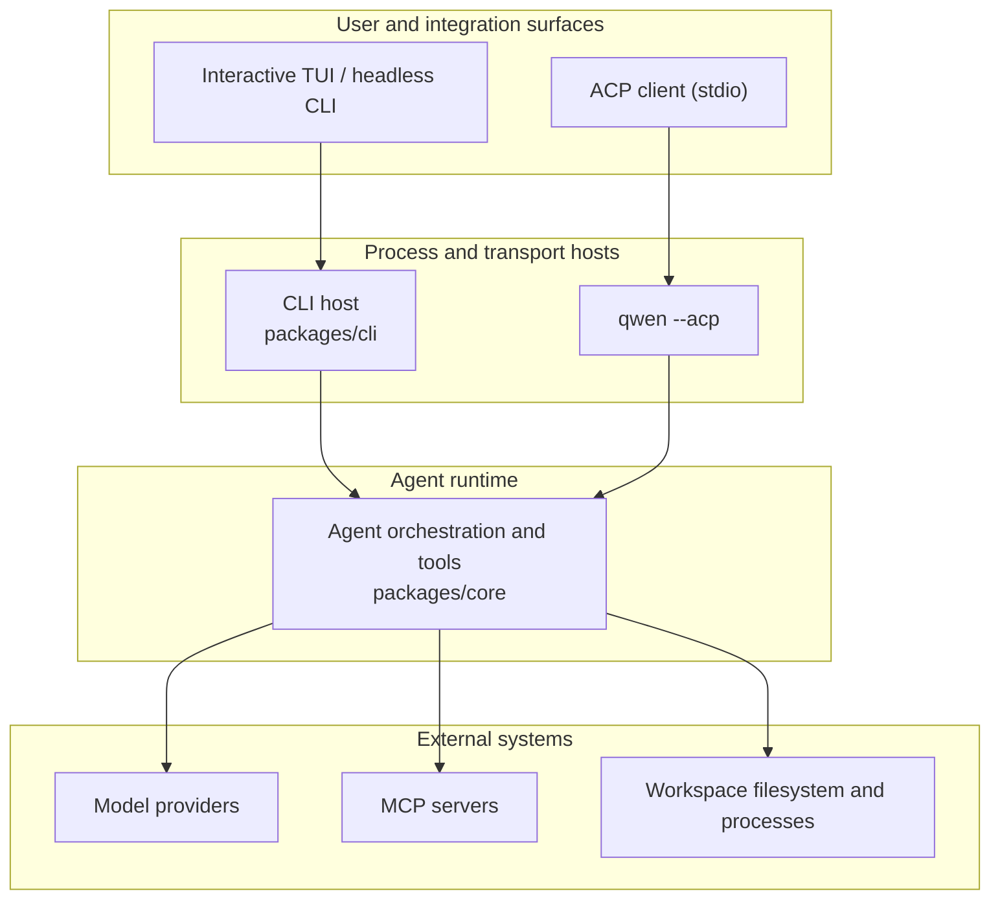

# Qwen Code Architecture Overview

Qwen Code is a monorepo that supports an interactive terminal, headless
execution, and the Agent Client Protocol (ACP) over stdio. This document maps
those surfaces to the packages that implement them and explains the main
runtime boundaries.

## System at a glance

Qwen Code has two agent execution models:

- **Direct execution:** the interactive TUI and headless CLI construct and run
  the agent runtime directly.
- **ACP execution:** `qwen --acp` hosts the agent behind an ACP transport
  over stdio, driven by an ACP client.

## Repository layout

| Path                     | Responsibility                                                                                                                                                                                   |
| ------------------------ | ------------------------------------------------------------------------------------------------------------------------------------------------------------------------------------------------ |
| `packages/cli`           | The `qwen` executable, argument parsing, configuration assembly, Ink TUI, headless output, ACP entry point, and command-specific adapters.                                                       |
| `packages/core`          | UI-independent agent orchestration, model-provider integration, prompt and context construction, tool registration and execution, permissions, sessions, memory, telemetry, and shared services. |
| `packages/acp-bridge`    | ACP channel lifecycle, session multiplexing, event delivery, permission mediation, process spawning, and the filesystem seam used by ACP client hosts.                                           |
| `packages/web-templates` | Web templates packaged as embeddable JavaScript and CSS strings.                                                                                                                                 |
| `integration-tests`      | End-to-end coverage for CLI, interactive, sandbox, hook, and terminal behavior.                                                                                                                  |
| `docs` and `docs-site`   | User, developer, and design documentation plus the documentation site.                                                                                                                           |
| `scripts`                | Build, packaging, release, validation, and repository-maintenance automation.                                                                                                                    |

Most code lives in npm workspaces under `packages/`. A package should depend on
another package through its declared public exports rather than through a
relative path into that package's source tree.

## Package boundaries

### CLI and presentation surfaces

`packages/cli` owns the executable and chooses the runtime mode from command-line
arguments. It loads user and workspace settings, constructs the core
configuration, enters the requested sandbox when necessary, and then starts one
of the interactive, headless, ACP, or maintenance flows.

Presentation remains outside the core runtime: the Ink TUI renders local
interactive sessions.

### Core runtime

`packages/core` owns the agent loop. It constructs model requests, maintains
conversation context, dispatches tool calls, applies permission policy, and
returns structured events and results to the active host. Built-in tools cover
file operations, shell execution, search, planning, web access, memory, skills,
and subagents. MCP extends the tool and resource surface without coupling the
runtime to a specific integration.

The core package does not decide how results are displayed or how a client
transports them. Those decisions belong to the CLI and bridge layers.

### ACP bridge

`packages/acp-bridge` connects a host process to an ACP agent runtime. Its main
responsibilities are:

- spawning or attaching to an ACP channel;
- multiplexing sessions and clients;
- forwarding prompts, cancellations, and ACP notifications;
- mediating permission requests;
- publishing bounded session event streams;
- providing a workspace filesystem interface to the host.

The bridge can use a real `qwen --acp` child process in production or an
in-memory channel in tests. See the
[`@qwen-code/acp-bridge` README](../../packages/acp-bridge/README.md) for its
public entry points.

## Runtime flows

### Direct CLI flow

1. The CLI parses arguments and resolves user, workspace, environment, and
   command-line configuration.
2. It prepares sandboxing and constructs the core runtime configuration.
3. The core runtime builds the model request and enters the agent/tool loop.
4. Tool calls are checked against permission policy and executed in the active
   workspace environment.
5. The CLI renders incremental events in the TUI or serializes them for
   headless output.

## Extension points

Qwen Code can be extended at several layers:

- **MCP servers** add tools, prompts, and resources to the core runtime.
- **Extensions and skills** package reusable commands, configuration, and agent
  behavior.

Keep platform-specific concerns in adapters. Shared agent behavior belongs in
the core runtime, while transport and wire behavior belongs in the ACP bridge.

## Configuration and state

The CLI assembles effective configuration from command-line arguments,
environment variables, user settings, workspace settings, and defaults before
constructing the runtime. The core receives the resolved configuration rather
than reading presentation-specific input. See
[Settings](../users/configuration/settings.md) for the supported settings and
their scopes.

Direct sessions persist their history and metadata through shared core
services.

## Where to go next

- [ACP bridge](../../packages/acp-bridge/README.md)
- [Tool development](./tools/introduction.md)
- [Integration testing](./development/integration-tests.md)
